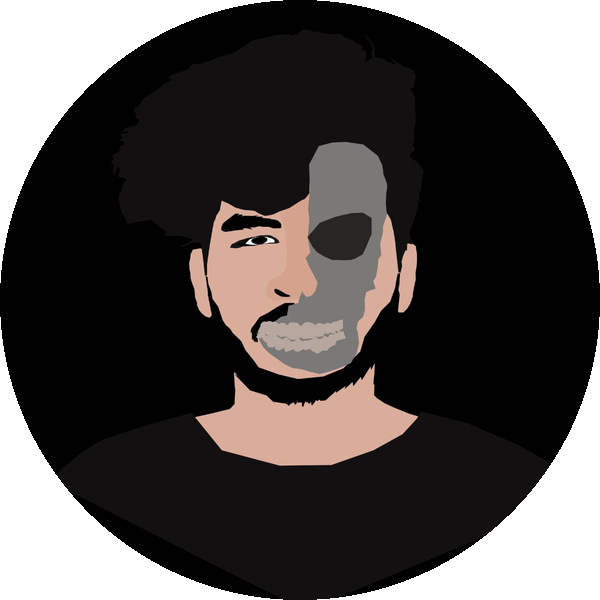
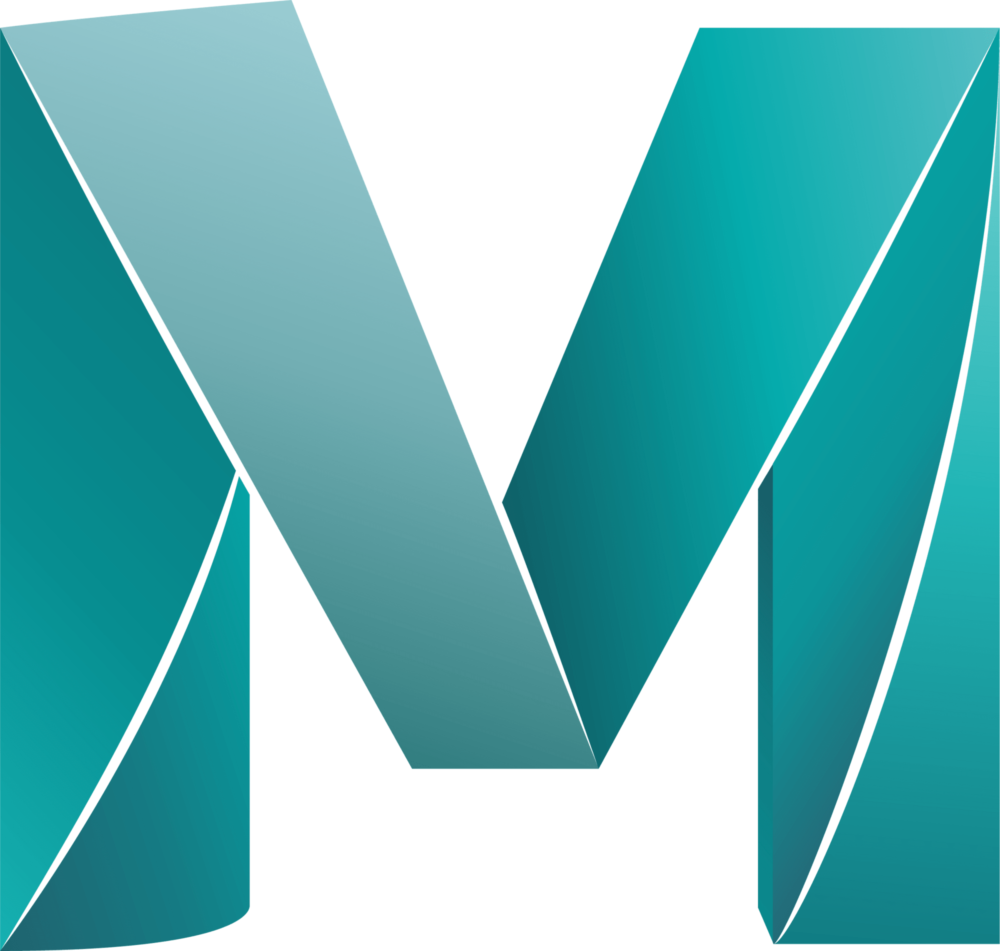
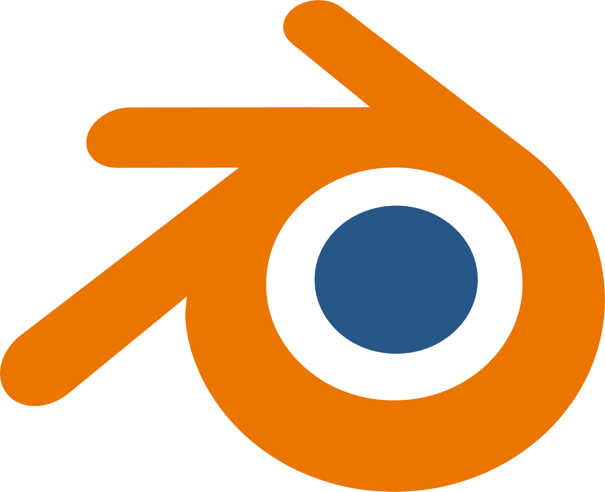
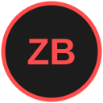
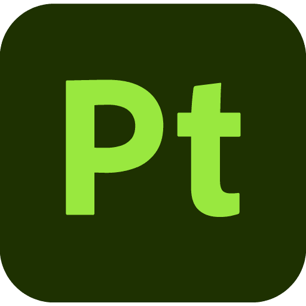
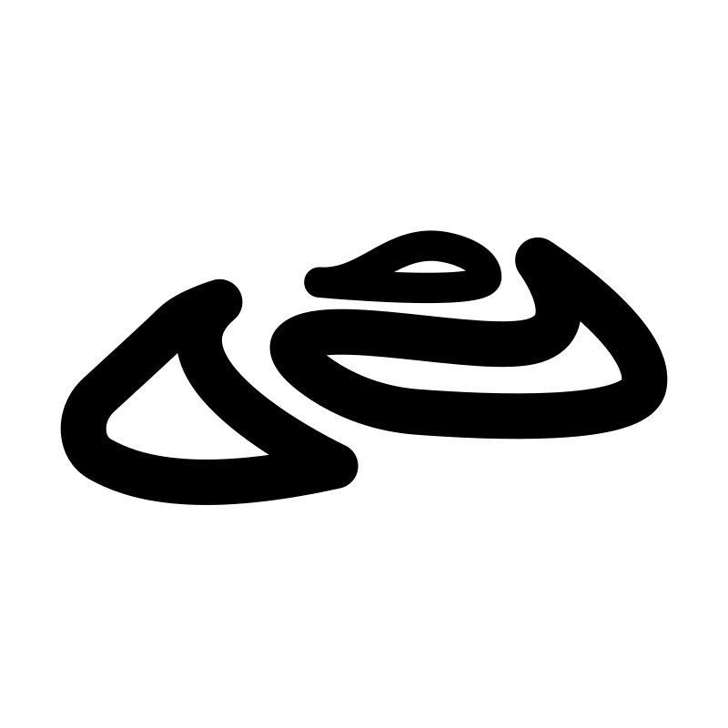
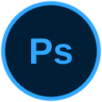
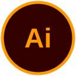
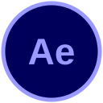
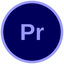

# Hi there, I'm Muhammed Ajmal KP 👋

### 3D Artist & 3D Character Animator · Dubai, UAE 🇦🇪

*Bringing character poses to life with weight, mechanics, and expressive performance.*

---

## 🎬 About Me

I'm a passionate **3D Artist and Character Animator** based in Dubai, UAE, with 3+ years of studio, corporate media, and architectural experience across the **UAE, Bahrain, and India**.

- 📍 **Location:** Dubai, UAE
- 🎭 **Focus:** Body mechanics, character performance, timing, expressive lip-sync, and cinematic motion
- 🚀 **Worked with:**
  - **Broeck Real Estate** (Dubai)
  - **DM Immigration Consultants** (Dubai)
  - **7 Toonz Animation Studio** (Bahrain)
  - **Assemblage Entertainment** (Mumbai, India)

---

<h2 align="center">🛠️ Software I Use</h2>

<table align="center">
  <tr>
    <td align="center" width="150"> <b>Maya</b></td>
    <td align="center" width="150"> <b>Blender</b></td>
    <td align="center" width="150"> <b>ZBrush</b></td>
  </tr>
  <tr>
    <td align="center" width="150"> <b>Substance Painter</b></td>
    <td align="center" width="150"> <b>Nomad Sculpt</b></td>
    <td align="center" width="150"> <b>Photoshop</b></td>
  </tr>
  <tr>
    <td align="center" width="150"> <b>Illustrator</b></td>
    <td align="center" width="150"> <b>After Effects</b></td>
    <td align="center" width="150"> <b>Premiere Pro</b></td>
  </tr>
</table>

---

<h2 align="center">🌐 Portfolio & Reels</h2>

  
  
  
  

  Designed with passion for 3D art & animation

